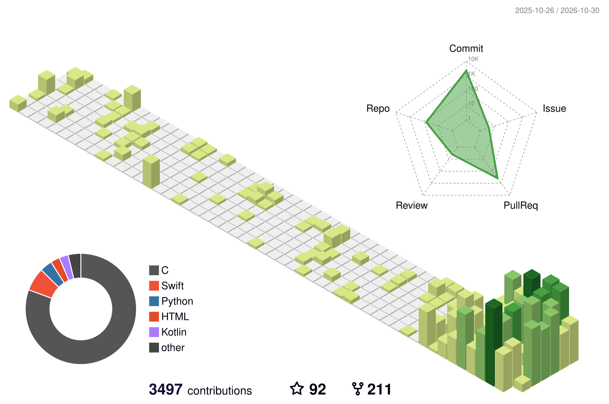

  

  

  
  
  
  
  

  
  
  

## 👋 About me

- 🐧 Computer engineer from Istanbul who would rather run Linux on it, whatever *it* is.
- 📡 Lately: putting **real Ubuntu / OpenWrt on ZTE F50 · MU300 · U30 Air 5G modems**, next to Android.
- 🧩 Building a whole ecosystem of **Magisk modules** for those modems: VPN gateway, Telegram status bot, SIP, IMS fixes, cell tools.
- 🍎 Writing native **macOS** apps (SwiftUI) and the occasional Hackintosh EFI.
- 🏎️ Side quests: a Forza Horizon telemetry dashboard, Kindle apps, Raspberry Pi gadgets.
- 💬 Ask me about embedded Linux, Android internals, networking and VPNs.

## 🚀 Spotlight

<table>
<tr>
<td width="60%" valign="top">

### [mu300-linux](https://github.com/dikeckaan/mu300-linux)

**Linux (Ubuntu 24.04 / 26.04 or OpenWrt) next to Android on the ZTE F50 / MU300 and U30 Air.**
Turn a pocket 5G MiFi into a real Linux box: full distro, your own packages, VPN, router — and Android still boots.

👉 **[Web installer](https://kaandikec.com/mu300-linux/)** · [VPN module](https://github.com/dikeckaan/mu300-linux-vpn) · [Flashing toolkit](https://github.com/dikeckaan/zte-f50-toolkit) · [Magisk modules](https://github.com/dikeckaan/f50-magisk-modules)

</td>
<td width="40%" valign="top">

</td>
</tr>
</table>

## ⭐ Most-starred projects

<!-- TOP-REPOS:START -->
| # | Project | Description | ⭐ Stars | 🍴 Forks | Language |
|:-:|---|---|:-:|:-:|---|
| 1 | [**mu300-linux**](https://github.com/dikeckaan/mu300-linux) | Linux (Ubuntu 24.04/26.04 or OpenWrt) next to Android on the ZTE F50 / MU300 and U30 Air 5G hotspots (Unisoc… | 742 | 119 | C |
| 2 | [**zte-f50-toolkit**](https://github.com/dikeckaan/zte-f50-toolkit) | ZTE F50 (5G MiFi) flashing toolkit — B09 downgrade, root, BL unlock, IMEI patch. Built on a custom spd_dump f… | 46 | 12 | C |
| 3 | [**MacOS-Workflow-VNC**](https://github.com/dikeckaan/MacOS-Workflow-VNC) | A free macOS desktop over VNC in about five minutes, on GitHub Actions with an ngrok tunnel. | 16 | 190 | Shell |
| 4 | [**macjaro**](https://github.com/dikeckaan/macjaro) | MacOS theme for Manjaro Gnome or any Arch based Gnome | 15 | 2 | CSS |
| 5 | [**easy-vphone**](https://github.com/dikeckaan/easy-vphone) | Native macOS GUI for vphone-cli with VM management and an integrated IPA library | 11 | 2 | Swift |
| 6 | [**mu300-linux-vpn**](https://github.com/dikeckaan/mu300-linux-vpn) | VPN toolkit for MU300 Linux (ZTE F50 / U30 Air): one command for Xray, sing-box, mihomo, WireGuard and OpenVP… | 11 | 2 | Python |
| 7 | [**f50-magisk-modules**](https://github.com/dikeckaan/f50-magisk-modules) | Index of Magisk modules for ZTE F50 (rooted Android, Unisoc UMS9620). Each module auto-updates via updateJson… | 6 | 1 | — |
| 8 | [**internetmerge**](https://github.com/dikeckaan/internetmerge) | Bond multiple network links into faster total internet — cross-platform, Mac-first (Connectify Dispatcher sty… | 6 | 1 | Go |
| 9 | [**mf286r-telnet-openwrt-exploit**](https://github.com/dikeckaan/mf286r-telnet-openwrt-exploit) | This guide provides step-by-step instructions to enable Telnet access on the ZTE MF286R router with stock fir… | 5 | 2 | PowerShell |
| 10 | [**OpenEUICC-5ber**](https://github.com/dikeckaan/OpenEUICC-5ber) | OpenEUICC with 5ber eSIM support: a free, open-source Local Profile Assistant for Android. | 5 | 1 | Kotlin |
<!-- TOP-REPOS:END -->

Updated daily by a workflow from public repositories only.

## 📌 Highlights

  
  
  
  
  
  

<b>🧩 The ZTE F50 Magisk module family</b>

 

| Module | What it does |
|---|---|
| [f50-magisk-modules](https://github.com/dikeckaan/f50-magisk-modules) | Index of all modules, each auto-updating |
| [magisk-zte-f50-statusbot](https://github.com/dikeckaan/magisk-zte-f50-statusbot) | Telegram bot: status, AT, shell, IMEI/SMS, Tailscale |
| [dikec-control-panel](https://github.com/dikeckaan/dikec-control-panel) | Xray VPN + web panel + Telegram bot + SMS hub |
| [magisk-zte-f50-vpn-gateway](https://github.com/dikeckaan/magisk-zte-f50-vpn-gateway) | Route the LAN through tun0, Tailscale-aware |
| [magisk-zte-f50-ims-voice-fix](https://github.com/dikeckaan/magisk-zte-f50-ims-voice-fix) | Keeps IMS voice alive with the screen off |
| [magisk-zte-f50-lite-mem](https://github.com/dikeckaan/magisk-zte-f50-lite-mem) | zram + debloat for the low-RAM F50 |
| [magisk-zte-f50-sip-server](https://github.com/dikeckaan/magisk-zte-f50-sip-server) | Embedded SIP server on UDP/5060 |
| [magisk-zte-f50-cell-tools](https://github.com/dikeckaan/magisk-zte-f50-cell-tools) | AT poller and cell tower intelligence |
| [magisk-zte-f50-cloudflared-tunnel](https://github.com/dikeckaan/magisk-zte-f50-cloudflared-tunnel) | Supervised Cloudflare Tunnel daemon |
| [magisk-zte-f50-bin-utils](https://github.com/dikeckaan/magisk-zte-f50-bin-utils) | Static aarch64 curl / jq / busybox / sendat |

## 🧰 Tech stack

   
  

## 📊 GitHub stats

  
  

  

  

<b>🧱 Contributions in 3D</b>

 
<picture>
  <source media="(prefers-color-scheme: dark)" srcset="profile-3d-contrib/profile-night-rainbow.svg">
  
</picture>

<picture>
  <source media="(prefers-color-scheme: dark)" srcset="https://raw.githubusercontent.com/dikeckaan/dikeckaan/output/github-snake-dark.svg">
  
</picture>

## 🕒 Recently updated

<!-- RECENT:START -->
- [**easy-vphone**](https://github.com/dikeckaan/easy-vphone) — Native macOS GUI for vphone-cli with VM management and an integrated IPA library · updated 2026-10-31
- [**dikeckaan.github.io**](https://github.com/dikeckaan/dikeckaan.github.io) — my web site · updated 2026-10-31
- [**mu300-linux**](https://github.com/dikeckaan/mu300-linux) — Linux (Ubuntu 24.04/26.04 or OpenWrt) next to Android on the ZTE F50 / MU300 and U30 Air… · updated 2026-10-31
- [**mu5358-linux**](https://github.com/dikeckaan/mu5358-linux) — OpenWrt on the ZTE U30 Pro (MU5358, UMS9632) 5G hotspot, next to Android, with its round… · updated 2026-10-30
- [**.github**](https://github.com/dikeckaan/.github) — No description · updated 2026-10-29
- [**bektasotokurtarma**](https://github.com/dikeckaan/bektasotokurtarma) — Bektaş Oto Kurtarma — cekici.online. İstanbul Anadolu Yakası 7/24 oto çekici. Cloudflare… · updated 2026-10-27
<!-- RECENT:END -->

## ⚡ Recent activity

<!--START_SECTION:activity-->
1. 🎉 Merged PR [#469](https://github.com/dikeckaan/mu300-linux/pull/469) in [dikeckaan/mu300-linux](https://github.com/dikeckaan/mu300-linux)
2. 🎉 Merged PR [#464](https://github.com/dikeckaan/mu300-linux/pull/464) in [dikeckaan/mu300-linux](https://github.com/dikeckaan/mu300-linux)
3. 💪 Opened PR [#469](https://github.com/dikeckaan/mu300-linux/pull/469) in [dikeckaan/mu300-linux](https://github.com/dikeckaan/mu300-linux)
4. 🎉 Merged PR [#465](https://github.com/dikeckaan/mu300-linux/pull/465) in [dikeckaan/mu300-linux](https://github.com/dikeckaan/mu300-linux)
5. 🗣 Commented on [#466](https://github.com/dikeckaan/mu300-linux/pull/466#issuecomment-6535796918) in [dikeckaan/mu300-linux](https://github.com/dikeckaan/mu300-linux)
6. 🎉 Merged PR [#467](https://github.com/dikeckaan/mu300-linux/pull/467) in [dikeckaan/mu300-linux](https://github.com/dikeckaan/mu300-linux)
<!--END_SECTION:activity-->

## 💖 Support

Everything I publish is a spare-time project and stays free. If one of them saved you a device, some money or an afternoon, you can give something back — one-off or monthly, it all helps.

  

A ⭐ on a repo you like helps too.

  

